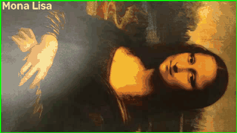
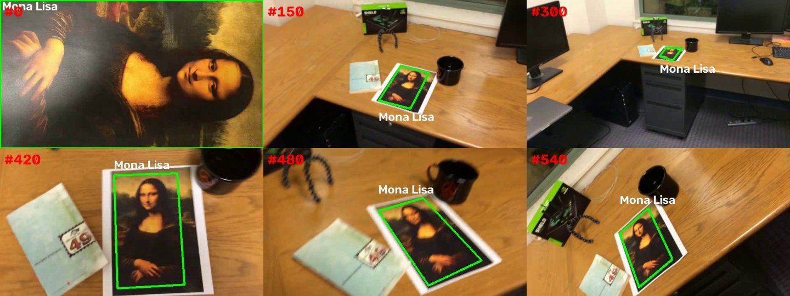
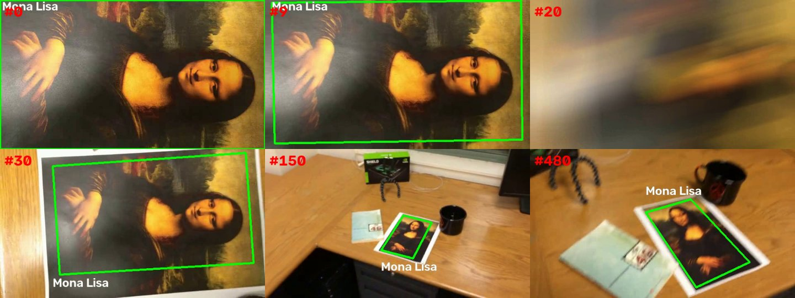
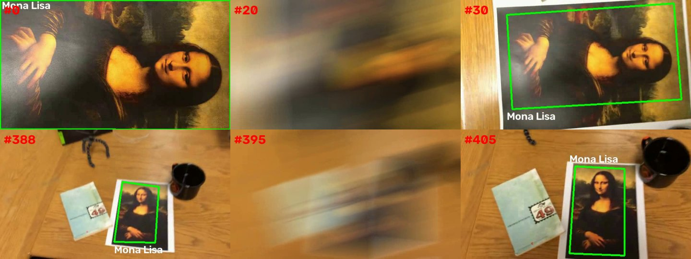
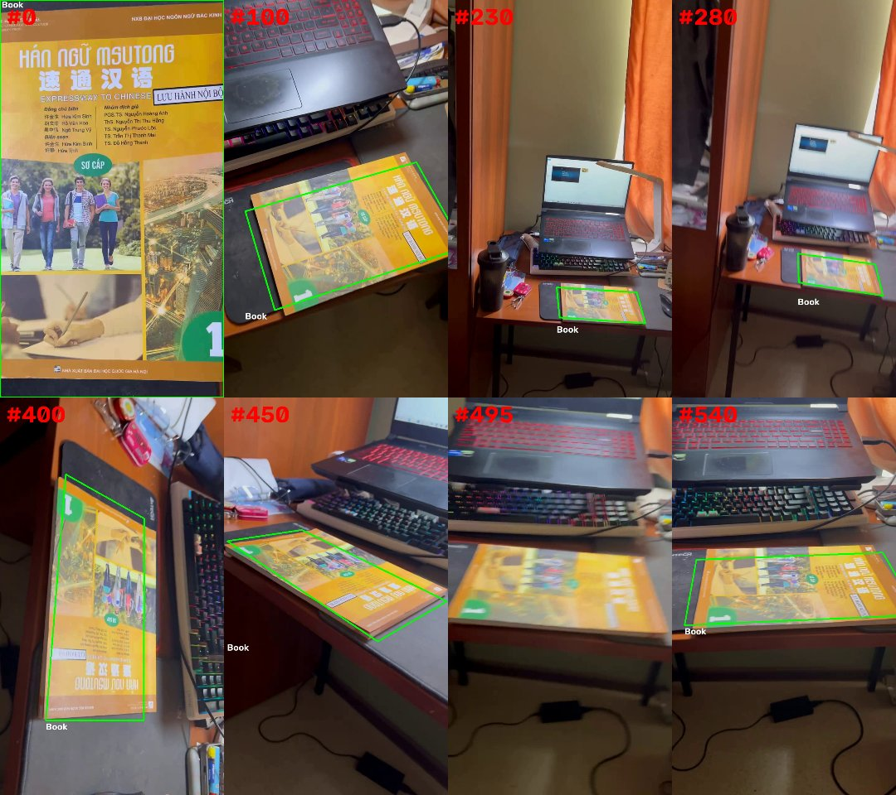

# ЛР2. Трекинг объекта на видео по ключевым точкам

**Цель работы:** реализовать простейший алгоритм трекинга объекта на видео на основе ключевых точек.

**Задание:** программа получает видео, первый кадр которого — крупное изображение объекта. На каждом кадре, где объект виден, вокруг него рисуется рамка с подписью. Объект плоский и прямоугольный, поэтому рамка должна повторять его реальные границы с учётом поворота и перспективы.



## 1. Теоретическая база

**Ключевые точки** — это характерные места изображения (углы, пятна, перепады яркости), которые можно надёжно найти снова на другом кадре. Для каждой точки вычисляется **дескриптор** — числовой вектор, описывающий её окрестность. Если дескрипторы двух точек близки, то, скорее всего, это одно и то же место объекта.

**SIFT** (Scale-Invariant Feature Transform) ищет ключевые точки как экстремумы разности гауссиан на разных масштабах и описывает каждую точку вектором из 128 чисел — гистограммами направлений градиента вокруг неё. Дескриптор устойчив к повороту, изменению масштаба и освещения, поэтому подходит для поиска объекта, который на видео поворачивается и отдаляется.

**Сопоставление точек.** Для каждой точки объекта ищутся две ближайшие по дескриптору точки кадра. Пара принимается, только если первая точка заметно ближе второй (тест отношения Лоу, `d1 < 0.75 · d2`). Это отсекает неоднозначные совпадения.

**Гомография** — матрица 3×3, которая описывает, как плоский объект переходит из одного изображения в другое при перспективной съёмке. Зная её, можно перенести четыре угла объекта с первого кадра на текущий и получить рамку, точно повторяющую границы объекта. Гомография вычисляется по 4 и более парам точек.

**RANSAC** — метод устойчивой оценки: многократно берутся случайные 4 пары, строится гомография и считается, сколько остальных пар с ней согласуются (inliers). Выбирается вариант с наибольшим числом согласованных пар, поэтому ошибочные совпадения не портят результат.

**Оптический поток Лукаса–Канаде** — метод, который находит, куда сдвинулась каждая точка между двумя соседними кадрами, исходя из того, что яркость точки почти не меняется. Он работает там, где SIFT не справляется (маленький или слегка смазанный объект), потому что сравнивает соседние кадры, которые почти не отличаются друг от друга.

## 2. Описание разработанной системы

Программа написана на Python с использованием OpenCV и NumPy. Весь код находится в файле [`tracker.py`](tracker.py).

**Архитектура:**

| Компонент | Назначение |
|---|---|
| `Tracker.__init__` | находит ключевые точки SIFT на первом кадре (образце) |
| `Tracker.detect` | способ 1: ищет объект на кадре по точкам SIFT |
| `Tracker.follow` | способ 2 (запасной): переносит точки с предыдущего кадра оптическим потоком |
| `Tracker.seed_flow` | после успешного поиска выбирает точки внутри рамки для оптического потока |
| `Tracker.homography` | считает гомографию методом RANSAC и проверяет, что рамка правильная |
| `Tracker.update` | обрабатывает один кадр: сначала способ 1, при неудаче способ 2 |
| `draw` | рисует рамку и подпись |
| `main` | читает видео, обрабатывает все кадры, сохраняет результат и выводит статистику |

**Алгоритм:**

1. Первый кадр видео считается образцом объекта, его четыре угла — границами объекта.
2. На образце ищутся точки SIFT в трёх масштабах (100 %, 50 %, 25 %). Так объект распознаётся и тогда, когда на видео он далеко и выглядит маленьким.
3. Для каждого следующего кадра:
   1. На кадре ищутся точки SIFT и сопоставляются с точками образца (тест отношения Лоу).
   2. По найденным парам методом RANSAC строится гомография. Если согласованных пар не меньше 12 и рамка получается выпуклым четырёхугольником, объект найден.
   3. Внутри найденной рамки выбираются хорошо отслеживаемые углы (`goodFeaturesToTrack`) — они понадобятся на следующем кадре.
   4. Если SIFT не нашёл объект, точки с предыдущего кадра переносятся оптическим потоком Лукаса–Канаде. Остаются только точки, которые при обратном переносе возвращаются на место с точностью до 1 пикселя. По ним снова строится гомография.
   5. Если не сработал ни один способ, считается, что объект не виден, и рамка не рисуется.
4. Четыре угла образца переносятся гомографией на кадр, рисуются рамка и подпись.

Гомография в обоих способах всегда считается от образца к текущему кадру, а не от кадра к кадру, поэтому ошибка не накапливается.

**Запуск:**

```bash
pip install opencv-python numpy
python tracker.py test-videos/mona-lisa.avi "Mona Lisa"
```

Результат сохраняется в `results/<имя видео>.mp4`, в консоль выводится статистика.

## 3. Результаты работы и тестирования системы

### 3.1 Тестовые видео

Тестовые видео: `mona-lisa.avi` — обычное; `mona-lisa-blur.avi` — то же видео, но кадры 10–28 сильно смазаны; `mona-lisa-blur-extra-credit.avi` — дополнительно смазаны кадры около 391–399. Видео `simple_track.avi` — приложенный образец, на нём уже нарисована эталонная рамка.

**mona-lisa.avi**



**mona-lisa-blur.avi**



**mona-lisa-blur-extra-credit.avi**



**simple_track.avi** (образец)


| Видео | Кадров | Объект найден | из них SIFT | из них оптический поток | Не найден |
|---|---|---|---|---|---|
| mona-lisa | 558 | 558 (100 %) | 331 | 227 | 0 |
| mona-lisa-blur | 558 | 539 (96,6 %) | 312 | 227 | 19 |
| mona-lisa-blur-extra-credit | 558 | 530 (95,0 %) | 302 | 228 | 28 |
| simple_track | 557 | 529 (95,0 %) | 216 | 313 | 28 |

Скорость обработки — около 17–20 кадров в секунду.

### 3.2 Собственное видео

Для проверки записано своё видео [`IMG_1557.mp4`](IMG_1557.mp4) (720×1280, 544 кадра): учебник с яркой обложкой, много текста и рисунков, то есть много ключевых точек. Первый кадр — обложка крупным планом, дальше камера отдаляется, обходит стол, поворачивает книгу и снова приближается.

```bash
python tracker.py IMG_1557.mp4 "Book"
```




| Видео | Кадров | Объект найден | из них SIFT | из них оптический поток | Не найден |
|---|---|---|---|---|---|
| IMG_1557 | 544 | 532 (97,8 %) | 438 | 94 | 12 |

Объект найден на 97,8 % кадров. Пропущены только кадры 488–499, где камера двигается быстро и кадр сильно смазан. На участках, где работает только оптический поток (около кадров 430–490), рамка иногда немного смещается относительно краёв книги, но после возвращения SIFT снова ложится точно.

Видео в высоком разрешении обрабатывается медленнее — около 3 кадров в секунду против 17–20 у тестовых видео 640×360, потому что SIFT ищет точки на кадре, который в 4 раза больше по площади.

### 3.3 Закономерности

- На обычном видео объект найден на всех кадрах, рамка совпадает с границами картины при повороте, наклоне и удалении камеры.
- Только SIFT находит объект примерно на 60 % кадров. Он теряет объект, когда картина далеко и занимает 60–80 пикселей: на ней остаётся слишком мало точек. Оптический поток закрывает эти участки, и итоговый результат поднимается до 95–100 %.
- Объект не найден только на кадрах с очень сильным смазом (10–28 и 391–399). Там картина неразличима даже на глаз, поэтому отсутствие рамки — правильное поведение.
- После смазанного участка объект находится снова сразу на первом чётком кадре, потому что SIFT каждый раз ищет его заново по образцу.
- На своём видео обложка книги текстурная, поэтому SIFT справляется сам на 80 % кадров, и оптический поток нужен реже, чем на видео с Моной Лизой.
- Рамка проходит по границе изображения картины, а не по белому краю листа, потому что образцом служит первый кадр, на котором видна только сама картина.

## 4. Выводы по работе

Реализован трекинг плоского объекта на видео по ключевым точкам. Связка SIFT + тест отношения + RANSAC-гомография позволяет найти объект на кадре и построить рамку, повторяющую его реальные границы с учётом перспективы. Одного SIFT недостаточно, когда объект маленький или смазан, поэтому добавлен запасной способ — оптический поток Лукаса–Канаде. Вместе они находят объект на 95–100 % кадров тестовых видео и на 97,8 % кадров собственного видео, а пропуски приходятся только на кадры, где объект не различим.
